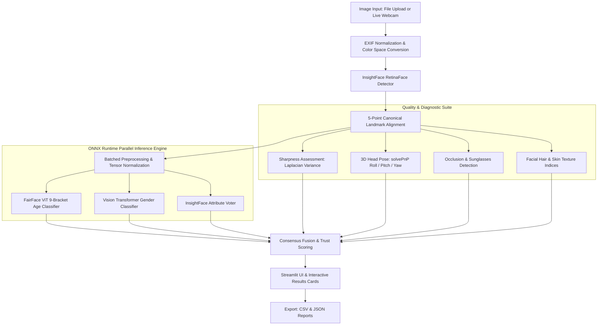

# 👤 Face, Age & Gender AI Detector

[](https://www.python.org/)
[](https://streamlit.io/)
[](https://onnxruntime.ai/)
[](https://github.com/deepinsight/insightface)
[](https://huggingface.co/jdp8/vit-age-classifier)
[](https://opensource.org/licenses/MIT)

A calibrated, multi-model facial analysis platform engineered for **sub-2-second CPU inference** with zero bulky PyTorch GPU dependencies. Features demographically balanced age estimation, dual-model consensus gender classification, metric-driven quality checks, and calibrated uncertainty scoring.

---

## 🌟 Key Features

- ⚡ **Ultra-Fast CPU Inference Engine**: Optimized via **ONNX Runtime** multi-threading and quantization for sub-2-second execution on standard CPUs.
- 🎯 **RetinaFace Detection & Canonical Alignment**: High-precision multi-face localization with **5-point canonical affine landmark alignment** (ArcFace/InsightFace reference).
- 🎂 **FairFace Vision Transformer Age Classifier**: Demographically balanced 9-bracket age distribution (`0-2`, `3-9`, `10-19`, `20-29`, `30-39`, `40-49`, `50-59`, `60-69`, `70+`) with credible interval estimation.
- 👥 **Dual-Model Gender Consensus**: Independent voter mechanism pairing an ONNX Vision Transformer with InsightFace to minimize demographic and algorithmic bias.
- 🛡️ **Metric-Driven Quality & Trust Scoring**:
  - **Sharpness Check**: Laplacian variance detection to identify motion blur.
  - **3D Head Pose Estimation**: Perspective-n-Point (`solvePnP`) roll, pitch, and yaw evaluation.
  - **Occlusion Detection**: Eye region contrast measurement to flag sunglasses and obstructions.
  - **Calibrated Uncertainty**: Classifies results into *High*, *Moderate*, *Low*, or *Uncertain* confidence tiers.
- 🔬 **Diagnostic Visual Cues**: Informational facial hair density and skin texture variance indices.
- 📸 **Flexible Input Modes**: Upload images (JPG, PNG, WEBP) with automatic EXIF orientation correction or capture directly via live webcam.
- 📊 **Analytics Dashboard & Data Export**: Interactive KPI overview, per-face diagnostic cards, and one-click **CSV** and **JSON** exports.
- 🎨 **Modern Dark UI**: Custom-styled glassmorphism design with responsive grid layouts, SVG icons, and visual legends.

---

## 🏗️ System Architecture



---

## 📁 Repository Structure

```text
face_detection_app/
│
├── app.py                  # Core application (Streamlit UI + ONNX Inference Pipeline)
├── requirements.txt        # Python package dependencies
├── .gitignore              # Git ignore rules for models, venvs, and cache
├── README.md               # Project documentation
│
├── models/                 # Model cache directory (populated automatically)
│   └── onnx_cache/         # Downloaded quantized ONNX ViT models
│
└── sample_images/          # Optional directory for test images
```

---

## 🚀 Quick Start

### 1. Prerequisites
- **Python**: Version `3.9` through `3.12`
- **C++ Build Tools** (Windows only, if compiling `insightface` wheels): Ensure Microsoft C++ Build Tools or Visual Studio with C++ tools is installed.

### 2. Clone the Repository
```bash
git clone https://github.com/your-username/face-detection-app.git
cd face-detection-app
```

### 3. Create a Virtual Environment
```bash
# Windows
python -m venv venv
.\venv\Scripts\activate

# macOS / Linux
python3 -m venv venv
source venv/bin/activate
```

### 4. Install Dependencies
```bash
pip install --upgrade pip
pip install -r requirements.txt
```

### 5. Launch the Application
```bash
streamlit run app.py
```

The application will launch in your default web browser at `http://localhost:8501`.

> **Note on First Run**: On initial launch, the app automatically downloads quantized ONNX model weights from Hugging Face into `models/onnx_cache/` (~83MB each) and InsightFace assets into `~/.insightface/`. Subsequent runs load instantly from local disk.

---

## ⚙️ Model Details & Sources

| Model | Purpose | Architecture | Source |
| :--- | :--- | :--- | :--- |
| **RetinaFace (`buffalo_l`)** | Face detection & 5-point landmark alignment | ResNet50 backbone | [InsightFace](https://github.com/deepinsight/insightface) |
| **FairFace ViT** | 9-bracket balanced age classification | Quantized Vision Transformer | [Hugging Face (`jdp8/vit-age-classifier`)](https://huggingface.co/jdp8/vit-age-classifier) |
| **ViT Gender** | Binary gender classification | Quantized Vision Transformer | [Hugging Face (`onnx-community`)](https://huggingface.co/onnx-community/gender-classification-ONNX) |

---

## 🎛️ UI Controls & Configuration

- **Detection Sensitivity (`0.15 - 0.75`)**: Adjusts face confidence threshold. Lower values detect smaller, distant, or partially occluded faces.
- **Compute Diagnostic Visual Cues**: Toggles informational facial hair density and skin texture indices.
- **Show 5-Point Facial Landmarks**: Overlays canonical alignment keypoints (eyes, nose, mouth corners) on detected faces.
- **Max Faces to Process (`1 - 30`)**: Limits the maximum number of faces evaluated in batched inference to ensure high throughput on dense crowds.

---

## 📊 Export Data Format

Exported analysis files (`CSV` or `JSON`) include the following attributes per detected face:

| Column / Key | Type | Description |
| :--- | :--- | :--- |
| `Person` | `int` | Sequential face index (ordered left-to-right) |
| `Gender` | `string` | Consensus label (`Male` or `Female`) |
| `Gender Confidence %` | `float` | Consensus confidence percentage |
| `Estimated Age Range` | `string` | Credible age span (e.g., `25 - 34`) |
| `Best Age Estimate` | `int` | Expected median age point |
| `Primary Group` | `string` | Dominant FairFace age bracket |
| `Group Confidence %` | `float` | Probability score for the dominant bracket |
| `Trust Tier` | `string` | Reliability rating (`High`, `Moderate`, `Low`, `Uncertain`) |
| `Trust Score %` | `float` | Composite confidence and image quality metric |
| `Quality` | `string` | Face crop image quality assessment (`Good`, `Fair`, `Poor`) |
| `Sunglasses Detected` | `bool` | Occlusion check indicator |

---

## 🔒 Ethical Use & Disclaimer

- Visual age and gender estimation are probabilistic predictions based on external phenotypic appearance.
- Lighting conditions, camera resolution, motion blur, makeup, and facial hair can influence model predictions.
- This application provides calibrated credible intervals and trust scoring to avoid false certainty. It is intended for research, creative, and analytics purposes.

---

## 📄 License

This project is licensed under the [MIT License](LICENSE).

